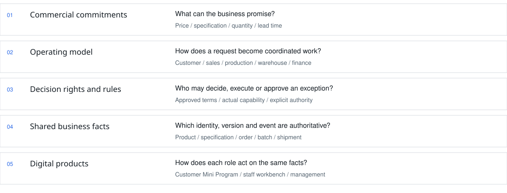

# Shixuan Lin

I construct enterprise operating frameworks and digital products, connecting commercial decisions, operational responsibilities, shared business facts and applied-AI workflows.

My enterprise-design framework connects five layers: commercial commitments, the operating model, decision rights and rules, shared business facts, and the digital interfaces used by customers, staff and management.

I hold a master's degree in Management and Systems from New York University, with a concentration in Database Technologies, and a Bachelor of Business Administration in Finance from Macau University of Science and Technology.

[Personal website](https://shixuanlin.com/) · [Online portfolio](https://shixuanlin.com/portfolio) · [20-page portfolio PDF](portfolio/Shixuan_Lin_Portfolio.pdf)

## Selected work

| Project | Business and development focus | Explore |
| --- | --- | --- |
| HHY enterprise digitalization | Operating framework, commercial rules, decision rights, shared data, management information and customer/staff products | [Enterprise case](projects/hhy-enterprise-and-miniapp.md) |
| FabricChain Intelligence | Industrial requirements, constraint-based retrieval, business-fact verification and the net value of AI in sourcing | [Prototype case](projects/fabricchain.md) |
| Media analysis | Document processing, NLP integration, structured outputs and professional human review | [Case study](projects/media-analysis.md) · [Public code](https://github.com/shixuanlin1/unicc) |
| AI safety testing | Governance-to-test mapping, agent workflows, risk evidence and organizational follow-up | [Framework and prototype](projects/ai-safety-testing.md) |

## How I frame enterprise digitalization

I connect the commercial cycle, physical fulfillment and financial control. A quotation, an accepted order, an actual shipment and a receipt have different meanings. Product and specification identities, transaction versions, permissions and audit make those differences explicit in the system.

My commercial-design work includes quantity and production constraints, the economic effect of changes after committed work, partial quotation acceptance and reliable delivery promises. I keep routine authorized work direct, while meaningful economic exceptions go to the appropriate decision-maker.

I evaluate the complete service: customer completion, staff verification, repeated data entry, correction effort and exception recovery. AI-generated recommendations are assessed through product fit, checking effort and the consequences of an unreliable business promise.

## Research and publications

I am a co-author of work on harmful media narratives and the determinants of carbon emissions in Macau. See [full publication details and author lists](publications.md).

Related work: [tool-using agent evaluation](projects/agent-safety.md) · [economic and financial research](projects/economics.md).

## Technical areas

My project work has involved Python, SQL, TypeScript, Vue, uni-app, Streamlit, Node.js/Fastify and PostgreSQL/Prisma. The case studies connect these tools to the business requirements, implementation decisions and original artifacts.

---

[GitHub repositories](https://github.com/shixuanlin1?tab=repositories)
