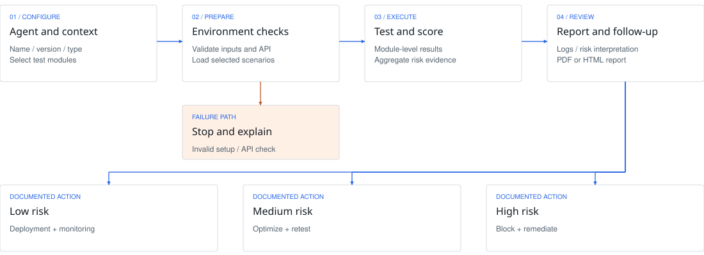

# AI safety testing framework and prototype

2025 / UNICC AI safety testing project

## The business problem

A safety framework becomes useful when someone can configure the evaluation, run the relevant checks and inspect the evidence behind the next action.

## My development work

I worked on framework design, the translation of governance requirements into test modules, scoring and reporting workflows, and prototype integration. The interface connects configuration, test selection, environment setup, execution, results and report review.

## Design and business decisions

### Validate before execution

The documented pipeline checks the configuration and API, prepares the selected scenarios and terminates with an explanation if the environment check fails.

### Keep module results traceable

Individual test modules produce results before risk evidence is aggregated. The report retains logs, risk descriptions and follow-up recommendations.

### Make follow-up explicit

The prototype distinguishes monitoring, optimization and retesting, and remediation. Its historical dashboard values illustrate the interface; they are not presented as benchmark results.

## System and interface

Original configuration interface from the December 2025 project presentation.

Evaluation flow redrawn from slides 12-13 of the original presentation. The linked resources retain their original project attributions.

## Project resources

- [Online portfolio](https://shixuanlin.com/portfolio#safety)
- [Full project record](https://shixuanlin.com/projects/ai-safety-testing-framework)
- [Open the framework project resource](https://github.com/Chen1212123/UNICC-AI-Safety-Testing-Framework)
- [20-page selected-work portfolio](../portfolio/Shixuan_Lin_Portfolio.pdf)

[Back to overview](../README.md)
