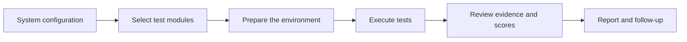
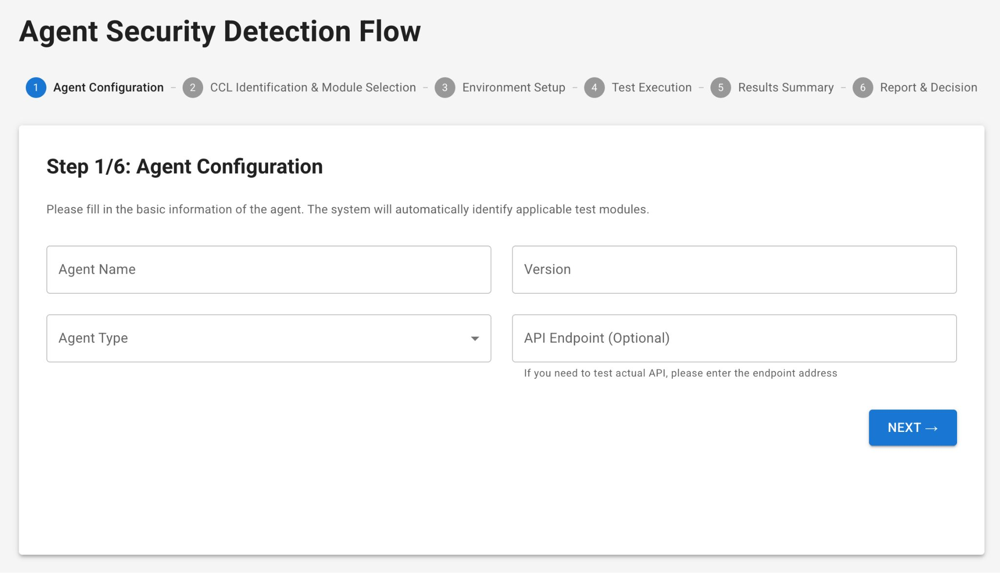
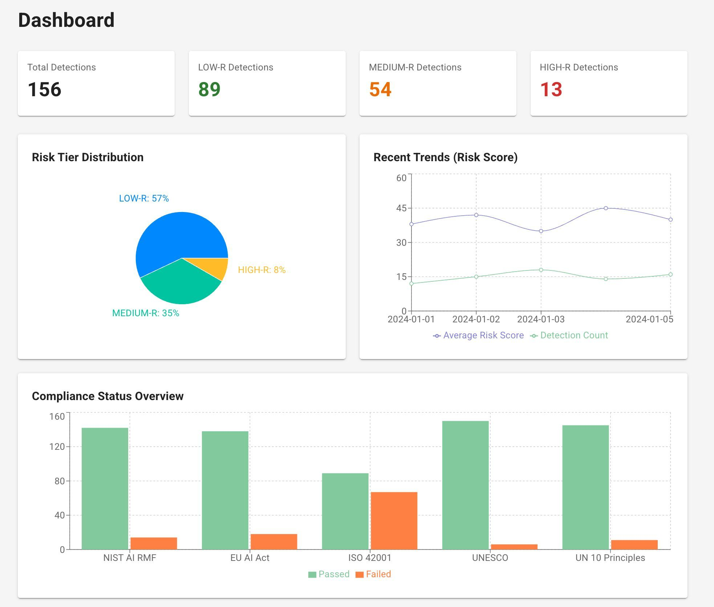

# AI safety testing framework and prototype

## Project context

I worked on an AI safety testing project that connects governance requirements, risk and capability assessment, automated tests, scoring and a review interface. The December 2025 project presentation documents the framework, agent workflow and prototype screens.

## Development work

My work covered framework design, translating risks into test modules, the testing and scoring workflow, interface development and prototype integration. The six-step interface connects agent configuration, module selection, environment setup, test execution, results and reporting.

The workflow makes invalid configuration and environment failures explicit. References to standards guide the evaluation design; a prototype score helps organize review rather than establish a formal conformity assessment.

## Original interface record

Original interface images from the December 2025 project presentation. Displayed dashboard values belong to the historical demonstration and are not treated as benchmark results here.

## Project resources

- [Framework project resource](https://github.com/Chen1212123/UNICC-AI-Safety-Testing-Framework)
- [Agent and interface project resource](https://github.com/jennieleei/UNICC-AI-Safety-Testing-Agent)

The original resource attributions remain in the linked repositories.

[Back to selected work](../README.md)
