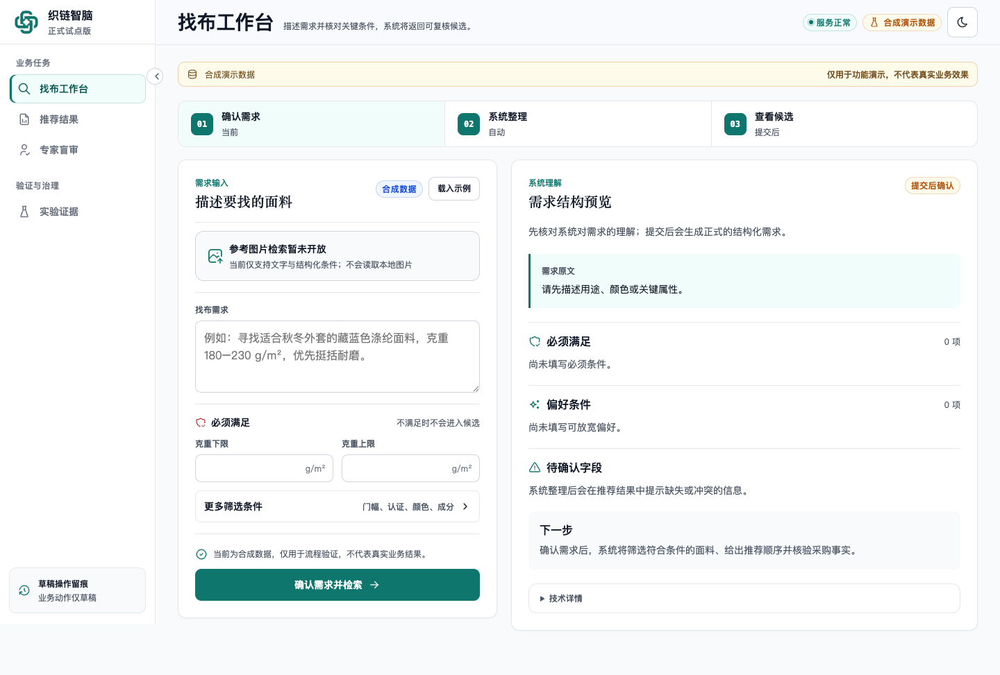
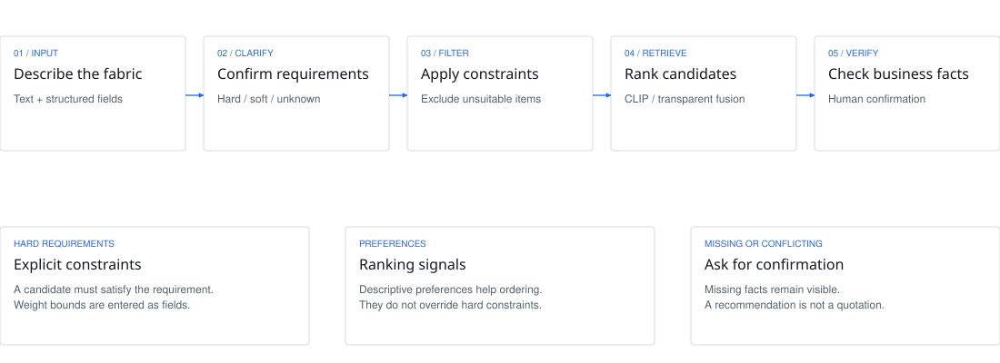

# FabricChain Intelligence

2026 / FabricChain Intelligence prototype

## The business problem

I designed the prototype around a commercial question: where can AI reduce sourcing effort while preserving specification fit and reliable customer commitments?

## My development work

The prototype combines requirement representation, retrieval, candidate evidence and human confirmation. I consider relevance alongside constraint violations, verification work and the consequences of an incorrect price, stock or delivery promise.

## Design and business decisions

### Separate requirements from preferences

Hard constraints determine whether a candidate is eligible. Descriptive preferences can influence ranking, while missing information stays visible for clarification.

### Make ranking understandable

The inspected version uses CLIP representations and transparent fusion. Historical extraction failures motivated explicit validation around structured requirements.

### Check the business consequence

Product facts, inventory, pricing and fulfillment conditions require an identified source and human confirmation. The workbench and engineering examples use synthetic demonstration data.

## System and interface

Historical workbench, July 2026. Synthetic demonstration data; reference-image input was not enabled on this screen.

Retrieval and confirmation flow redrawn from historical prototype records.

## Project resources

- [Online portfolio](https://shixuanlin.com/portfolio#fabric)
- [Full project record](https://shixuanlin.com/projects/fabricchain-intelligence)
- [Read the prototype record](https://github.com/shixuanlin1/shixuanlin1.github.io/blob/master/projects/fabricchain.md)
- [20-page selected-work portfolio](../portfolio/Shixuan_Lin_Portfolio.pdf)

[Back to overview](../README.md)
