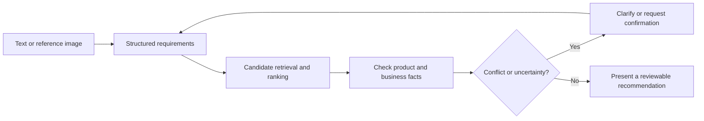

# FabricChain Intelligence

## From a fabric request to a reviewable recommendation

Customers describe fabrics through a mixture of text, reference images, technical requirements, and business constraints. I worked on a prototype that turns those inputs into structured requirements, retrieves candidates, and presents information that a person can check before making a business commitment.

My work covered prototype architecture, requirement representation, workflow integration, and interfaces for inspecting candidate evidence. AI-assisted implementation supported this development process.

## Workflow

## Engineering choices

I kept hard constraints distinct from model-generated descriptions. A model may help interpret a request or explain a candidate, while stock, pricing, and other business facts need an identified source and an appropriate confirmation path.

The historical implementation includes deterministic structured-field parsing and a local CLIP-based text/image retrieval path. In the inspected engineering version, candidate reranking uses dual-encoder representations and transparent fusion rather than a cross-encoder. I describe these components separately so that an architectural diagram does not imply capabilities the inspected implementation does not contain.

## Evidence and limits

Historical prototype screenshot from July 2026. It presents structured requirements and explicit uncertainty using synthetic demonstration data. Reference-image input was not enabled on this particular screen.

Local project records document real model execution on synthetic engineering fixtures. Other historical stress-test records describe failures of model-based requirement extraction under hard constraints; that finding motivated keeping structured decisions behind explicit validation.

These are prototype and engineering observations. They do not establish commercial effectiveness, production readiness, or a general improvement in recommendation quality. A stronger evaluation would require an authorized dataset, expert judgments, comparable baselines, and a clean source revision tied to the reported run.

## Next evaluation

I want to compare candidate relevance with constraint violations, clarification effort, and the cost of incorrect recommendations. This connects model selection to the operational decision that the person reviewing the result must make.

[Back to profile](../README.md)
