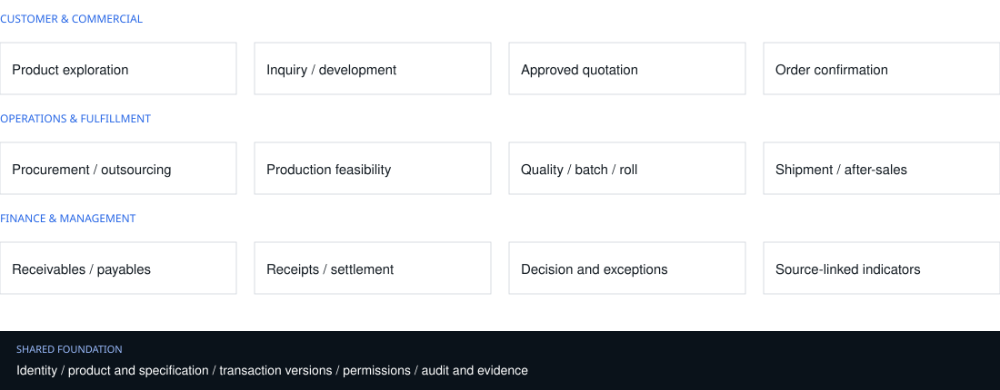

# HHY enterprise digitalization

2025-Present / Honghuayuan Fabric / Enterprise digitalization

## The business problem

I constructed an enterprise operating framework connecting customer commitments, fulfillment and financial control, then translated it into business rules, shared data objects, decision rights and digital workflows.

## My development work

My work connects business requirements and rules, enterprise information architecture, customer and staff interfaces, backend integration and AI-assisted implementation. The management system and Mini Program are different views of the same operating model.

## Design and business decisions

### Organize capabilities around the business cycle

I connect the commercial cycle, fulfillment and financial control. Customer, staff and management views use shared product, transaction, work and audit references.

### Give data identity a business meaning

A tradable product, specification revision, batch, dye lot and physical roll represent different objects. Accepted terms and subsequent changes retain the applicable version.

### Separate decision rights

Pricing and economic exceptions, production feasibility, financial verification and physical execution belong to different responsibilities. Technical administration does not automatically confer business-approval authority.

### Control the customer commitment

Quotation, order confirmation, production, shipment, receivable and receipt have different meanings. Each transition needs the relevant facts, authority and evidence.

### Model commercial edge cases

I distinguish commercial quantity thresholds from technical production floors, retain the economic effect of committed work during changes, recheck the conditions behind partial quotation acceptance, and verify real capacity before a delivery promise.

### Balance control with operating cost

Authorized staff can execute approved terms directly. Meaningful commercial exceptions escalate. Drafts can remain incomplete until an action actually requires the missing information.

### Evaluate the complete service

Removing an early registration barrier for overseas buyers improved access but shifted verification work to staff. I therefore consider customer completion, staff checking, repeated data entry, correction effort and recovery together.

### Define the management view before the dashboard

Demand and commitments, fulfillment and constraints, and cash and exposure form linked management views. Indicators should lead back to the underlying event and an accountable next action.

## System and interface

Product home. Local H5 development capture, November 2026.

Recovery state. Historical local H5, October 2026, using synthetic records.

Enterprise capability model redrawn from operating rules and system records: commercial work, fulfillment, finance and management share the same business foundation.

## Project resources

- [Online portfolio](https://shixuanlin.com/portfolio#hhy)
- [Full project record](https://shixuanlin.com/projects/b2b-digital-operations-platform)
- [Open the Mini Program project record](https://github.com/shixuanlin1/miniprogramforcompanydemo)
- [20-page selected-work portfolio](../portfolio/Shixuan_Lin_Portfolio.pdf)

[Back to overview](../README.md)
