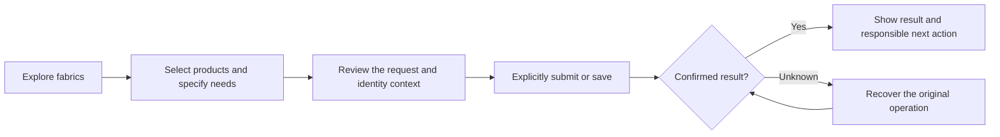
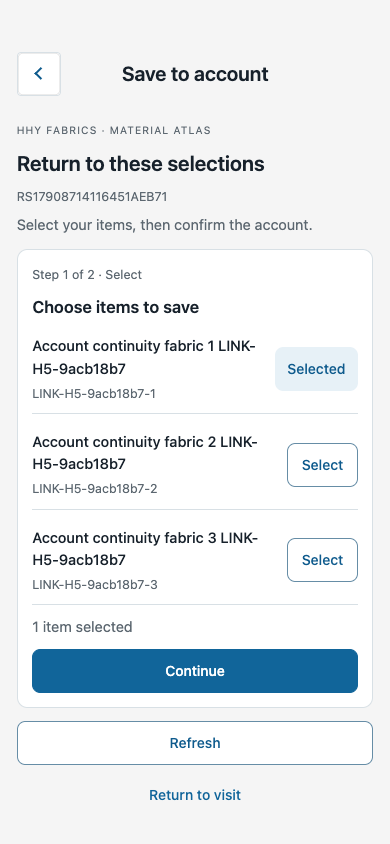
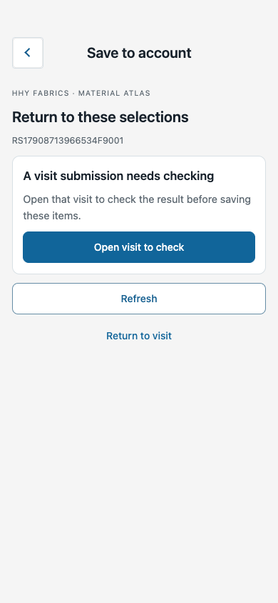

# HHY enterprise platform and WeChat Mini Program

## The problem

A fabric inquiry can involve a customer, sales staff, sample preparation, pricing, inventory, and subsequent follow-up. A usable customer screen is only one part of that service: staff also need to know which product and request are involved, who may act, and which result has actually been confirmed.

I worked on business requirements, information architecture, interface design, and AI-assisted implementation for an enterprise platform and its WeChat Mini Program. My technical work involved Vue 3, TypeScript, uni-app, Node.js/Fastify, and PostgreSQL/Prisma.

## Design decisions

### Browsing and business authority

I separated product exploration from actions that require an identified account or enterprise authorization. Providing contact details, saving selected products, and obtaining permission to act for a company are different operations. The interaction should make each transition deliberate.

### Saving a selection

For account linking, I used a sequence of selecting items, reviewing differences, explicitly saving, and inspecting the result. Product identifiers, quantities, units, and notes remain visible when two versions differ. Existing account content is not silently overwritten.

### Recovering an uncertain operation

If a submission loses its response, the interface should help recover the original operation before attempting another write. I worked on keeping recovery associated with the original visit and request so that an unresolved action in one context cannot become a success message in another.

### Coordinating the next action

Customer-facing progress and staff-facing responsibility need a shared business reference. I worked on distinguishing a request from an issued quotation, sample preparation from dispatch, and an offered handover from an accepted responsibility.

## Service flow

## Verification and evidence

  
  

Historical local H5 screenshots from October 2026, using synthetic records. The first shows deliberate item selection; the second keeps an uncertain submission associated with its original visit.

Historical local development records from October 2026 document tests of account linking, visit isolation, authorization changes, versioned drafts, and recovery after a lost response. Those records describe selected development environments and synthetic test data. They do not by themselves establish the current production state or native-device acceptance of the complete product.

The public [admin repository](https://github.com/shixuanlin1/hhy-fabric-admin) is an earlier template-based snapshot. It should be read with its upstream attribution and does not represent the full current enterprise backend. The [Mini Program repository](https://github.com/shixuanlin1/miniprogramforcompanydemo) is the intended public case-study entry point.

## What I want to investigate next

I want to evaluate whether a simpler customer journey reduces total service effort, including staff verification and exception handling. A useful study would compare completion time, correction work, successful recovery, and responsibility clarity across the entire service rather than count front-end clicks alone.

[Back to profile](../README.md)
