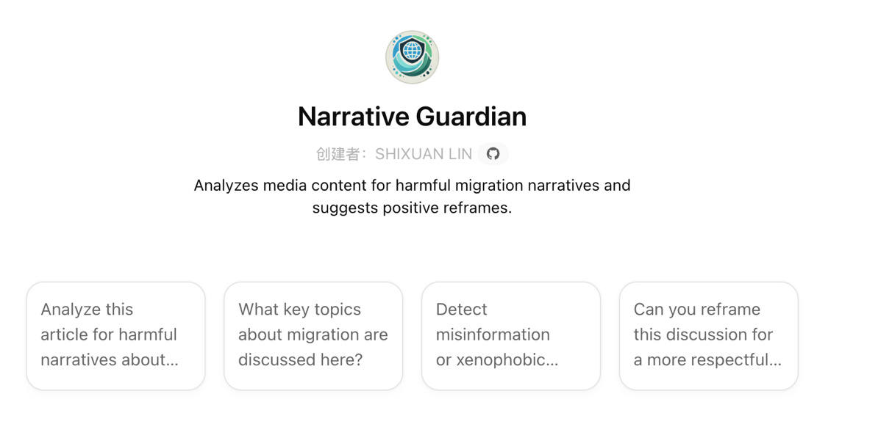

# Reviewing harmful narratives in news

For this 2024 UNICC-sponsored project at NYU, I built the document processing and connected the modules that detect harmful language, check facts and terminology, and identify the article's topic. Reviewers could work through a chatbot or upload a document in Streamlit.

One integration problem was deciding what counted as a usable response. The Streamlit app displays a classification only when the model also returns a reason. Sentiment, topic and keywords are optional. You can see that decision in [the parser](https://github.com/shixuanlin1/unicc/blob/main/demo.py#L32-L47).

[Streamlit code and setup](https://github.com/shixuanlin1/unicc) · [Co-authored IEEE paper](https://doi.org/10.1109/ISEC64801.2025.11147198) · [Full project](https://shixuanlin.com/projects/multilingual-content-safety-analysis)
