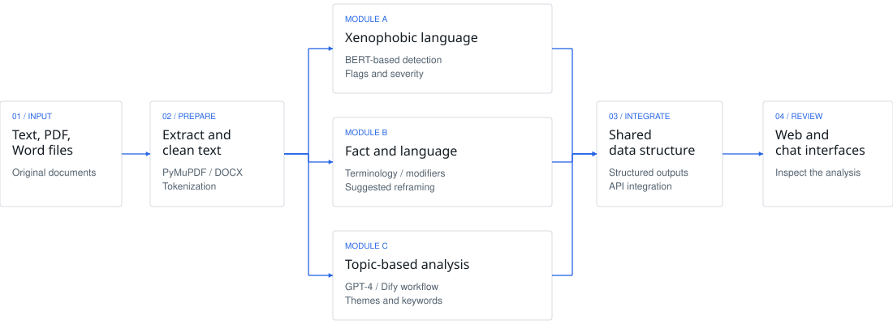

# Media analysis for professional review

2024 / UNICC-sponsored NYU applied project

## The business problem

A news article can contain harmful language, problematic terminology and broader narrative framing. I developed a workflow that connects these analytical tasks with document handling and interfaces for human review.

## My development work

My work covered preprocessing, analytical modules, API integration, structured outputs and the Streamlit application. The original project report documents three modules, a chatbot, a web interface and the integration process.

## Design and business decisions

### Separate the analytical tasks

BERT-based language detection, fact and language validation, and GPT-4-based topic analysis each produce distinct information for the reviewer.

### Agree the integration contract

When module formats did not match, I worked on a common JSON structure and integration checks. The public app also exposes its tagged output parser: Classification and Reason are required; the remaining fields are optional.

### Connect implementation and research

The deliverables include the application, project report and a related co-authored paper at IEEE ISEC 2025. The public Streamlit/Dify snapshot makes the application layer inspectable.

## System and interface

Original chatbot interface from the 2024 applied-project report, Figure 5-4.

Architecture redrawn from the project report. The report describes the broader BERT/GPT-4 system; the public archive preserves the Streamlit/Dify application snapshot.

## Project resources

- [Online portfolio](https://shixuanlin.com/portfolio#media)
- [Full project record](https://shixuanlin.com/projects/multilingual-content-safety-analysis)
- [Inspect the public implementation](https://github.com/shixuanlin1/unicc)
- [20-page selected-work portfolio](../portfolio/Shixuan_Lin_Portfolio.pdf)

[Back to overview](../README.md)
